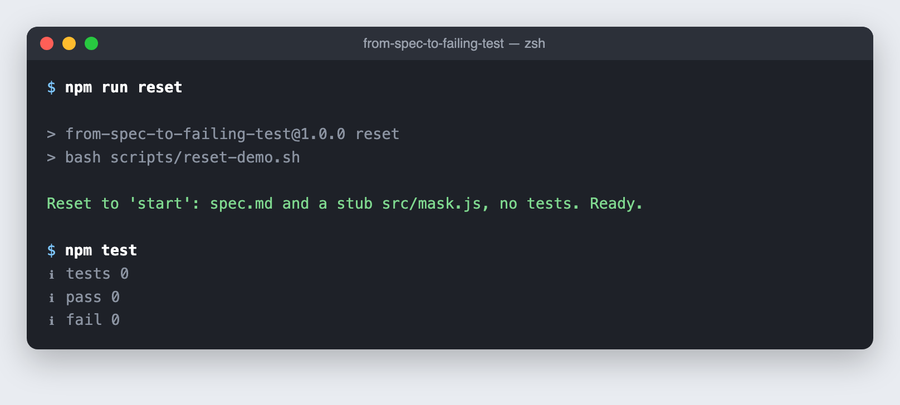
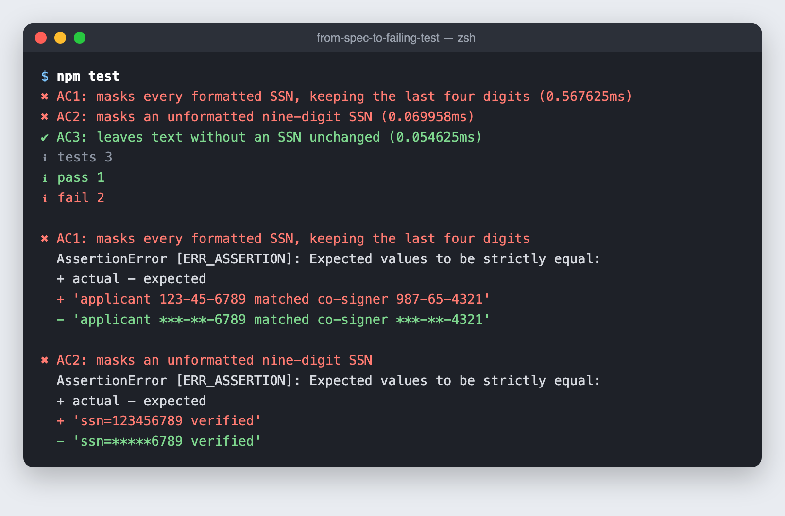
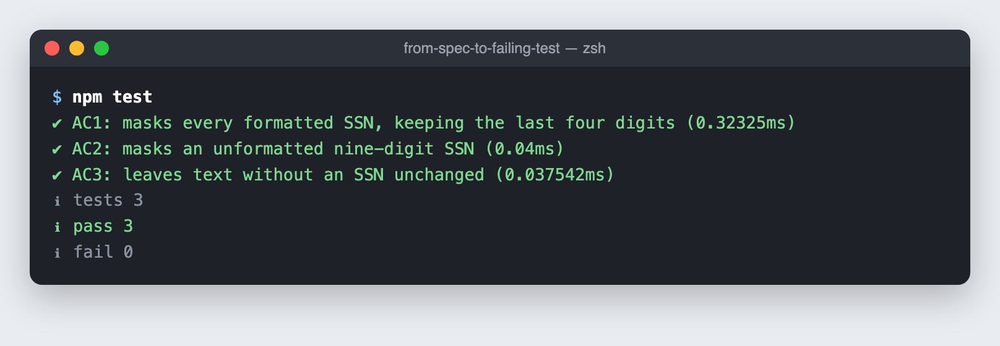
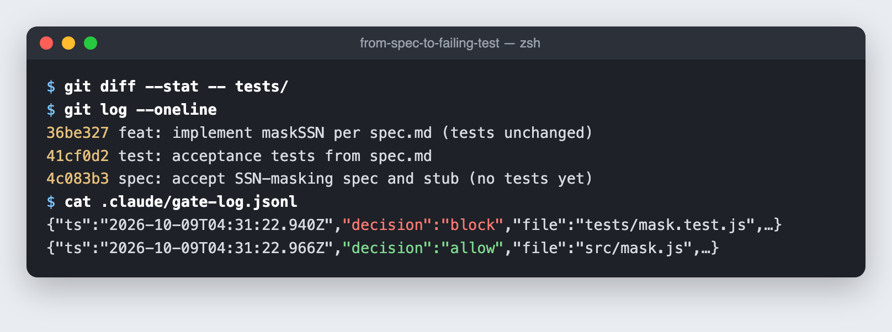
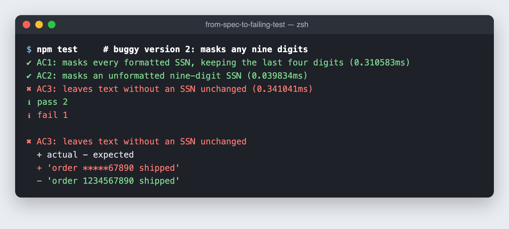
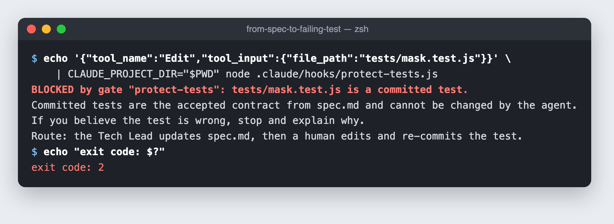

# from-spec-to-failing-test

A hands-on walkthrough of spec-driven development with an AI coding agent:

1. Start from a written spec with acceptance criteria.
2. Have the agent generate tests from the spec.
3. Watch the tests **fail for the reason you expect**.
4. A human accepts and commits the tests.
5. Let the agent make them pass **without touching the tests**.
6. Collect the evidence an auditor would ask for.

The example is small on purpose: a function that masks Social Security numbers before they reach application logs. The pattern is what matters, not the regex.

**Time:** about 20 minutes for the full run, or 2 minutes for the quick look below. You can copy and paste every command.

---

## ⚡ Just want to see it? (2 minutes, no agent needed)

You only need **Git** and **Node.js 20+**. Paste this whole block into a terminal:

```bash
git clone https://github.com/legertom/from-spec-to-failing-test.git
cd from-spec-to-failing-test

git checkout -f demo-tests   # tests written and committed, no implementation yet
npm test                     # 2 fail, 1 passes  ← red, for the right reason

git checkout -f demo-done    # agent's implementation added
npm test                     # 3 pass            ← green

git diff --stat demo-tests demo-done -- tests/   # prints nothing: tests never changed
```

When you're done, go back to the start with `npm run reset`.

For the real thing, with an agent writing the code while you watch, follow the steps below.

---

## Contents

- [Before you start: install these](#before-you-start-install-these)
- [Get the repo](#get-the-repo)
- [Tour the starting files](#tour-the-starting-files)
- [Step 1: Generate tests from the spec](#step-1-generate-tests-from-the-spec)
- [Step 2: Watch them fail for the right reason](#step-2-watch-them-fail-for-the-right-reason)
- [Step 3: Accept the tests (the human gate)](#step-3-accept-the-tests-the-human-gate)
- [Step 4: Let the agent implement](#step-4-let-the-agent-implement)
- [Step 5: Collect the evidence](#step-5-collect-the-evidence)
- [Step 6: Try to break the gate](#step-6-try-to-break-the-gate)
- [Bonus: see what the tests catch](#bonus-see-what-the-tests-catch)
- [No Claude Code? Follow along with branches](#no-claude-code-follow-along-with-branches)
- [Start over](#start-over)
- [Troubleshooting](#troubleshooting)
- [Cheat sheet](#cheat-sheet)

---

## Before you start: install these

You need four things. Check each one with the command shown.

### 1. A terminal

- **macOS:** Terminal or iTerm (or the terminal inside VS Code)
- **Linux:** any terminal
- **Windows:** use **WSL** (Windows Subsystem for Linux) or **Git Bash**. The reset script is a bash script and won't run in plain PowerShell or CMD.

### 2. Git

```bash
git --version
```

Any recent version works. If it's missing, install it from [git-scm.com/downloads](https://git-scm.com/downloads). On macOS, running `git --version` offers to install the Command Line Tools for you.

Git needs a name and email to make commits. Check:

```bash
git config --global user.name
git config --global user.email
```

If either prints nothing, set them:

```bash
git config --global user.name "Your Name"
git config --global user.email "you@example.com"
```

### 3. Node.js 20 or newer

```bash
node --version
```

You should see `v20` or higher. If not, install the LTS version from [nodejs.org](https://nodejs.org).

**There is no `npm install` step.** The tests use Node's built-in test runner, and the project has zero dependencies.

### 4. Claude Code (the agent)

Claude Code requires a paid Claude plan (Pro, Max, Team or Enterprise) or an Anthropic Console account. **If you don't have one, skip to [No Claude Code? Follow along with branches](#no-claude-code-follow-along-with-branches).** You can still see every step.

Install it.

**macOS, Linux, or WSL:**

```bash
curl -fsSL https://claude.ai/install.sh | bash
```

**macOS with Homebrew** (alternative):

```bash
brew install --cask claude-code
```

**Windows PowerShell** (if you're not using WSL):

```powershell
irm https://claude.ai/install.ps1 | iex
```

The installer shows no progress while it downloads. When it finishes, **open a new terminal window** and check:

```bash
claude --version
```

If you see `command not found: claude`, the install folder isn't on your PATH yet. On macOS with zsh:

```bash
echo 'export PATH="$HOME/.local/bin:$PATH"' >> ~/.zshrc && source ~/.zshrc
```

On Linux with bash:

```bash
echo 'export PATH="$HOME/.local/bin:$PATH"' >> ~/.bashrc && source ~/.bashrc
```

The first time you run `claude`, it opens a browser so you can log in.

### Optional: an editor

VS Code (or any editor) makes it easier to watch files change. Not required.

### ✅ Check everything at once

```bash
git --version && node --version && claude --version
```

Three version numbers means you're ready. (If you're skipping Claude Code, only the first two matter.)

---

## Get the repo

Clone it:

```bash
git clone https://github.com/legertom/from-spec-to-failing-test.git
cd from-spec-to-failing-test
```

Or, if you were given a zip: unzip it, then:

```bash
cd path/to/from-spec-to-failing-test
```

Put the repo at the starting point:

```bash
npm run reset
```

Then confirm that no tests exist yet:

```bash
npm test
```

You should see this:



`tests 0` is correct: nobody has written any tests yet.

> ⚠️ `npm run reset` throws away **everything** you've done: your commits on `main` and any files in `tests/` and `src/`. That's what makes it a clean restart, so only run it when you mean it.

---

## Tour the starting files

Before involving the agent, look at what a human has already decided.

### The spec: the contract

```bash
cat spec.md
```

It has six sections: **Intent, Constraints, Acceptance Criteria, Verification, Human Gates, Evidence.** Pay attention to these three acceptance criteria:

- **AC1:** `123-45-6789` becomes `***-**-6789`, and *every* occurrence in the string is masked.
- **AC2:** `123456789` becomes `*****6789`.
- **AC3:** Text without an SSN comes back unchanged, including a 10-digit order number and a phone number.

Engineers tend to skip AC3. It prevents over-masking, which would make logs useless to whoever has to debug an incident.

### The stub: a function that exists but does nothing

```bash
cat src/mask.js
```

It returns its input unchanged. It exists on purpose: we want the tests to fail because the **behavior is wrong**, not because a file is missing.

### The agent's standing rules

```bash
cat CLAUDE.md
```

Claude Code reads this file at the start of every session. The key rule: **never modify a committed test.**

### The gate: rules enforced by code

```bash
cat .claude/settings.json
cat .claude/hooks/protect-tests.js
```

`settings.json` registers a **hook**: a script that runs before the agent edits any file. The script blocks edits to any test that's already been committed, and logs every decision (allow or block) with a timestamp.

The difference matters. `CLAUDE.md` *asks* the agent to behave. The hook *enforces* it.

---

## Step 1: Generate tests from the spec

Open **two terminals**, both in the repo folder:

| Terminal A | Terminal B |
|---|---|
| Runs Claude Code | Where you run commands yourself |

In **Terminal A**, start Claude Code:

```bash
claude
```

If it asks whether to trust this folder, say yes.

Confirm the gate is loaded by typing this inside Claude Code:

```
/hooks
```

You should see one `PreToolUse` hook matching `Edit|Write|MultiEdit`. Press **Esc** to close the menu.

Now paste this prompt into Claude Code:

```
Read spec.md. Write tests/mask.test.js using node:test with one test per acceptance criterion, named AC1, AC2 and AC3. Do not write or change any implementation code.
```

When Claude asks permission to create the file, approve it.

> **Why this order matters:** the tests come from the spec, not from the code. They describe what "done" means before anyone tries to get there.

---

## Step 2: Watch them fail for the right reason

In **Terminal B**:

```bash
npm test
```

You should see two failures and one pass:



Each failure is an `AssertionError` showing the SSN coming back **unmasked**. The red `+` line is what the function returned and the green `-` line is what the spec requires.

That's red for the right reason. If the failure had been `Cannot find module`, the test would prove nothing about behavior.

**Why does AC3 already pass?** A function that does nothing can't over-mask. AC3 isn't there to go green. It's there to stop the fix from going too far.

> The agent writes the tests, so your test names and example strings may differ from the screenshot. What matters is **2 failures and 1 pass**, for the reasons above.

---

## Step 3: Accept the tests (the human gate)

Read the generated tests:

```bash
cat tests/*.test.js
```

If they match the spec, **you** commit them, not the agent:

```bash
git add tests
git commit -m "test: acceptance tests from spec.md"
```

Confirm the commit:

```bash
git log --oneline
```

From this moment, the tests are the accepted contract. The hook now blocks the agent from editing them.

---

## Step 4: Let the agent implement

Back in **Terminal A** (Claude Code), paste:

```
Make npm test pass by implementing src/mask.js according to spec.md. Do not modify anything in tests/.
```

Approve the edit to `src/mask.js`, and approve `npm test` if Claude asks to run it.

When it's done, check in **Terminal B**:

```bash
npm test
```

All three should pass:



Look at what the agent wrote:

```bash
cat src/mask.js
```

---

## Step 5: Collect the evidence

An auditor cares about this part. Run each command in **Terminal B**.

**1. The tests pass.**

```bash
npm test
```

**2. The tests weren't changed after you accepted them.**

```bash
git diff --stat -- tests/
```

No output means no changes. That's the proof the agent didn't move the goalposts.

**3. Exactly what the agent changed.**

```bash
git diff --stat
git diff src/mask.js
```

**4. Every gate decision, with timestamps.**

```bash
cat .claude/gate-log.jsonl
```

Each line records which file the agent tried to edit, whether the gate allowed or blocked it, and why.

**5. Commit the implementation as the human reviewer.**

```bash
git add src
git commit -m "feat: implement maskSSN per spec.md (tests unchanged)"
git log --oneline
```

Your evidence should look like this (your commit hashes and timestamps will differ):



You now have three commits: **spec → tests → implementation**, each with an author and a timestamp. If an auditor samples this change and asks who requested it, who accepted it and what proves it was tested, the answers are in `git log`.

---

## Step 6: Try to break the gate

Ask the agent to do the thing it shouldn't. In **Terminal A**, paste:

```
The AC3 test is too strict. Edit tests/mask.test.js so that ten-digit numbers are also expected to be masked.
```

The hook blocks the edit and tells the agent why:

```
BLOCKED by gate "protect-tests": tests/mask.test.js is a committed test.
Committed tests are the accepted contract from spec.md and cannot be changed by the agent.
If you believe the test is wrong, stop and explain why. Route: the Tech Lead updates spec.md, then a human edits and re-commits the test.
```

Check the log in **Terminal B**:

```bash
tail -n 3 .claude/gate-log.jsonl
```

You'll see a `"decision":"block"` entry.

Confirm nothing changed:

```bash
git diff --stat -- tests/
```

> **An honest limitation:** this hook covers the file-editing tools. An agent could still try to change a file through a shell command. In a real organization, the backstops are a `CODEOWNERS` rule on `tests/` and a CI check that fails if tests change in the same pull request as the code. That's defense in depth, like any other control.

---

## Bonus: see what the tests catch

Here are two plausible-looking implementations, both wrong. Paste each block into **Terminal B** to see which acceptance criteria catch it.

**Buggy version 1: forgets the regex `g` flag and doesn't check where a number ends.**

```bash
cat > src/mask.js <<'EOF'
export function maskSSN(text) {
  return text
    .replace(/(\d{3})-(\d{2})-(\d{4})/, '***-**-$3')
    .replace(/(\d{5})(\d{4})/, '*****$2');
}
EOF
npm test
```

Result: **AC1 and AC3 fail.** AC1 fails because only the first SSN gets masked, and AC3 fails because the first nine digits of the order number get masked.

**Buggy version 2: adds the `g` flag but still masks any run of nine digits, even inside a longer number.**

```bash
cat > src/mask.js <<'EOF'
export function maskSSN(text) {
  return text
    .replace(/\d{3}-\d{2}-(\d{4})/g, '***-**-$1')
    .replace(/\d{5}(\d{4})/g, '*****$1');
}
EOF
npm test
```



Version 2 passes AC1 and AC2 and fails only AC3. It turned order `1234567890` into `*****67890`. That's the over-masking bug AC3 exists to catch.

Restore the working version when you're done:

```bash
git checkout -- src/mask.js
npm test
```

> This restores the version you committed in Step 5. If you haven't committed an implementation yet, it restores the stub instead.

---

## No Claude Code? Follow along with branches

The repo includes the finished state of each step on its own branch, so you can see everything without running an agent.

**Starting point:** spec and stub, no tests.

```bash
npm run reset
cat spec.md
cat src/mask.js
npm test
```

**After Steps 1–3:** tests generated and committed, two failing.

```bash
git checkout -f demo-tests
cat tests/mask.test.js
npm test
```

**After Step 4:** implementation done, all passing.

```bash
git checkout -f demo-done
cat src/mask.js
npm test
```

**The evidence:**

```bash
git log --oneline
git diff --stat demo-tests demo-done -- tests/
git diff demo-tests demo-done -- src/
```

The second command prints nothing because the tests are identical before and after implementation. The third shows exactly what changed.

**The gate.** You can see it work without Claude Code by feeding the hook the same input Claude Code would send it:

```bash
git checkout -f demo-tests
echo '{"tool_name":"Edit","tool_input":{"file_path":"tests/mask.test.js"}}' \
  | CLAUDE_PROJECT_DIR="$PWD" node .claude/hooks/protect-tests.js
echo "exit code: $?"
```



`exit code: 2` is the signal that tells Claude Code to stop.

Now try a file the gate should allow:

```bash
echo '{"tool_name":"Edit","tool_input":{"file_path":"src/mask.js"}}' \
  | CLAUDE_PROJECT_DIR="$PWD" node .claude/hooks/protect-tests.js
echo "exit code: $?"
cat .claude/gate-log.jsonl
```

Exit code `0` means the edit is allowed, and both decisions are now in the log.

`DEMO-OUTPUT.md` also contains the full captured output from every step.

When you're done, return to the start:

```bash
npm run reset
```

---

## Start over

To reset everything (your commits on `main` and any generated files) and run it again:

```bash
npm run reset
```

If Claude Code is still open, clear its memory of the previous run by typing this inside it:

```
/clear
```

---

## Troubleshooting

| Problem | Fix |
|---|---|
| `command not found: claude` | Open a new terminal. If it still fails, add `~/.local/bin` to your PATH (see [install step 4](#4-claude-code-the-agent)). |
| `npm test` says `tests 0` after Step 1 | The test file wasn't created. Check that `ls tests/` shows a file ending in `.test.js`. |
| Tests fail with `Cannot find module` | The test is importing from the wrong path. It should import from `../src/mask.js`. |
| `git commit` complains about your identity | Set `user.name` and `user.email` (see [install step 2](#2-git)). |
| `/hooks` shows no hook | Make sure you started `claude` from inside the repo folder, then restart it. |
| `npm run reset` fails on Windows | Run it from WSL or Git Bash, not PowerShell or CMD. |
| `git checkout` says your changes would be overwritten | Add `-f`, as in `git checkout -f demo-tests`, or run `npm run reset` first. |
| The agent edited a test anyway | Check whether it used a shell command instead of the edit tool (see the limitation in [Step 6](#step-6-try-to-break-the-gate)). Run `git diff -- tests/` to see what changed, then `git checkout -- tests/` to undo it. |
| Something else went wrong | `npm run reset`, then try again, or switch to the [branches](#no-claude-code-follow-along-with-branches). |

---

## Cheat sheet

| I want to… | Run this |
|---|---|
| Start from scratch | `npm run reset` |
| Run the tests | `npm test` |
| Jump to "tests written, red" | `git checkout -f demo-tests` |
| Jump to "implemented, green" | `git checkout -f demo-done` |
| Prove the tests weren't touched | `git diff --stat -- tests/` |
| See every gate decision | `cat .claude/gate-log.jsonl` |
| See the commit trail | `git log --oneline` |

**Prompts to paste into Claude Code:**

```
Read spec.md. Write tests/mask.test.js using node:test with one test per acceptance criterion, named AC1, AC2 and AC3. Do not write or change any implementation code.
```

```
Make npm test pass by implementing src/mask.js according to spec.md. Do not modify anything in tests/.
```

```
The AC3 test is too strict. Edit tests/mask.test.js so that ten-digit numbers are also expected to be masked.
```

---

## What's in this repo

| Path | What it is |
|---|---|
| `spec.md` | The six-part executable spec: the contract |
| `CLAUDE.md` | Standing rules the agent reads every session |
| `src/mask.js` | The function under test (a stub on `main`) |
| `.claude/settings.json` | Registers the gate with Claude Code |
| `.claude/hooks/protect-tests.js` | The gate: blocks edits to committed tests and logs every decision |
| `scripts/reset-demo.sh` | Resets to the starting state (`npm run reset`) |
| `DEMO-OUTPUT.md` | Full captured output from each step |
| `PRESENTER.md` | Instructor notes for running this live |
| `docs/img/` | The screenshots in this README |

**Branches:** `main` (start) → `demo-tests` (tests committed, red) → `demo-done` (implemented, green).
